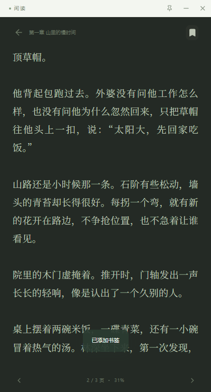

# 闲读

一个手机尺寸的 Tauri 2 桌面小说阅读器。React + TypeScript + Rust，书籍与阅读记录只保存在本机，无账号、无远程书城。

**[下载 Windows 便携版](https://github.com/Louyongqing/xiandu-reader/releases/latest)** · **[功能与问题反馈](https://github.com/Louyongqing/xiandu-reader/issues)** · **[MIT License](LICENSE)**

<p>
  
  
</p>

## 功能

- 手机尺寸的独立桌面窗口，支持调整大小、拖动与置顶。
- TXT / EPUB / MOBI / AZW3 / FB2 / PDF 本地书架，批量导入、去重、搜索、收藏与排序。
- 左右点击、滑动、滚轮与键盘翻页，目录跳转、书签和自动续读。
- 四种阅读背景、可调字号与行距，支持分页和滚动阅读。
- F8 / Esc 切换工作便签，随时回到原来的阅读位置。

## 使用

在 [Releases](https://github.com/Louyongqing/xiandu-reader/releases) 下载 `xiandu-reader-0.1.0-windows-x64.zip`，解压后双击 `闲读.exe`。系统需要 Microsoft Edge WebView2 Runtime。

- 默认窗口为 **420 × 780**，可拖动顶部标题栏，缩放到最小 340 × 560；图钉按钮切换窗口置顶。
- 点右上角 `+`，选择本地文件；也可以直接拖入窗口。支持多文件导入、相同内容去重、搜索、排序、列表视图、收藏和移除。
- 阅读时点左侧上一页、右侧下一页、中间打开菜单；支持左右滑动、鼠标滚轮、方向键、Page Up / Page Down 和空格翻页。
- 菜单提供目录、书签、夜间模式和排版设置。支持宋体 / 黑体、14–28 号字、三档行距、四种背景，以及滑动 / 无动画 / 滚动模式。
- 阅读位置按正文偏移保存，修改字体、调整窗口后会定位到包含原位置的页面。
- 窗口获得焦点时，按 **F8 或 Esc** 切换工作便签，再按一次回到阅读；Esc 优先关闭弹窗。便签内容也在本机保存。这个快捷键不是系统全局热键。
- 书架附三篇原创内置试读，可随时删除，删除后不会在下次启动时重新出现。

## 格式范围

| 格式 | 支持内容 |
| --- | --- |
| TXT | UTF-8、UTF-16、GB18030 / GBK，自动识别常见中英文章节标题 |
| EPUB | 按 spine 顺序读取正文、书名、作者与常见图片封面 |
| MOBI / AZW3 | 无 DRM 的 Kindle 电子书正文；支持 KF8 与带 KF8 内容的混合 MOBI |
| FB2 | FictionBook 正文与书籍信息 |
| PDF | 保留原始页面，支持翻页、缩放和书签，包括扫描页面 |

单本最大 50 MB；EPUB 解压内容限制 120 MB。EPUB、MOBI、AZW3、FB2 使用统一的**文字排版**，不复刻原书样式和内页插图，不适合纯图片漫画。PDF 保留原页，因此不应用小说文字字号 / 行距。加密电子书和需要密码的 PDF 会给出明确提示，不提供 DRM 解锁。

书籍正文、封面、进度与书签保存在 IndexedDB；阅读偏好与便签保存在 localStorage。数据位于这台设备的 WebView2 应用数据中；移动可执行文件不会导出书架。浏览器预览与桌面程序有各自独立的书架。

## 开发与构建

需要 Node.js 22.12+（或 24+）、Rust stable、Windows C++ 构建工具及 WebView2 Runtime。

```powershell
git clone https://github.com/Louyongqing/xiandu-reader.git
cd xiandu-reader
npm ci
npm run tauri -- dev
```

浏览器开发预览：

```powershell
npm run dev
# http://127.0.0.1:1420
```

构建 Windows 可执行文件：

```powershell
npm run tauri -- build --no-bundle
# src-tauri/target/release/xiandu-reader.exe
```

需要 NSIS 安装器时运行 `npm run tauri -- build`。配置已提供，但当前交付使用便携版。

## 验证

```powershell
npm test
npm run build
npm run format:check
cargo fmt --check --manifest-path src-tauri/Cargo.toml
```

浏览器验收（先在一个终端运行 `npm run preview -- --port 1420`）：

```powershell
python -m pip install playwright
python -m playwright install chromium
python tests/ui_checks.py
```

脚本生成原创 TXT / EPUB / FB2 / MOBI / PDF 测试文件，覆盖导入、去重、错误提示、翻页、跨章、字号重排、340 × 560 小窗口、书签、夜间模式、便签、滚动续读、PDF 缩放和持久化。结果及截图位于被忽略的 `test-results/`。

运行 `./tests/run-native.ps1` 可以测试真实打包应用。测试启动器临时设置 `WEBVIEW2_ADDITIONAL_BROWSER_ARGUMENTS=--remote-debugging-port=9224` 与独立的 `WEBVIEW2_USER_DATA_FOLDER`，完成后关闭测试进程并恢复环境变量；交付程序没有启用远程调试。可选 AZW3 检查读取系统临时目录下 `xiandu-format-check/sample.azw3`，测试书籍不随程序分发。

## 安全与依赖

- 导入的 HTML 只用于提取文字，脚本、样式、链接和外部资源不会被插入阅读页面。
- Tauri 仅授予关闭、最小化、拖动、置顶与修改标题权限；没有 shell、任意文件系统或网络插件。
- CSP 限制本地资源，PDF 字体 / CMap / WASM 解码资源随程序打包，无 CDN 请求。
- Kindle 解析在独立 Worker 中运行，30 秒超时会终止解析；损坏文件逐本报告，不影响已导入的书。

主要依赖：[Tauri](https://v2.tauri.app/)、[React](https://react.dev/)、[PDF.js](https://github.com/mozilla/pdf.js)、[lingo-reader](https://github.com/hhk-png/lingo-reader)、[JSZip](https://github.com/Stuk/jszip)、[idb](https://github.com/jakearchibald/idb)、[Lucide](https://lucide.dev/)。各依赖保留其原有许可证。

## 开源许可与贡献

本项目源码、界面与内置原创试读采用 [MIT License](LICENSE)。第三方依赖及其资源保留原有许可证，详见 [THIRD_PARTY_NOTICES.md](THIRD_PARTY_NOTICES.md)。JSZip 选择其 MIT 许可选项。

欢迎提交 Issue 和 Pull Request。问题反馈请附操作系统、应用版本、复现步骤；格式问题可以附不包含隐私且有权公开的最小测试文件。提交代码前请运行 `npm test`、`npm run format:check` 和 `npm run build`。

Windows 依赖许可证清单可在依赖安装完成后运行 `npm run notices` 重新生成。若发布其他平台的二进制，请针对相应 Cargo target 更新清单。
